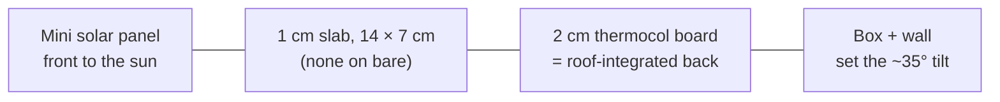
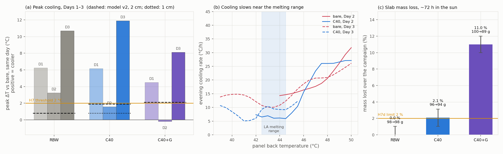
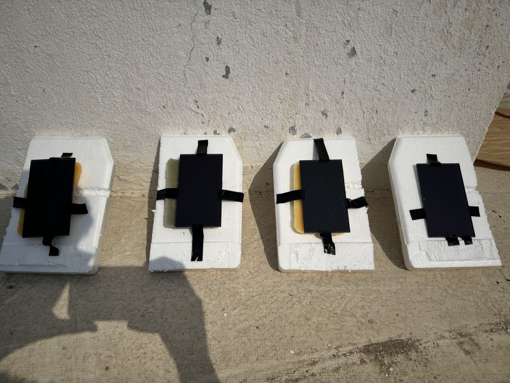
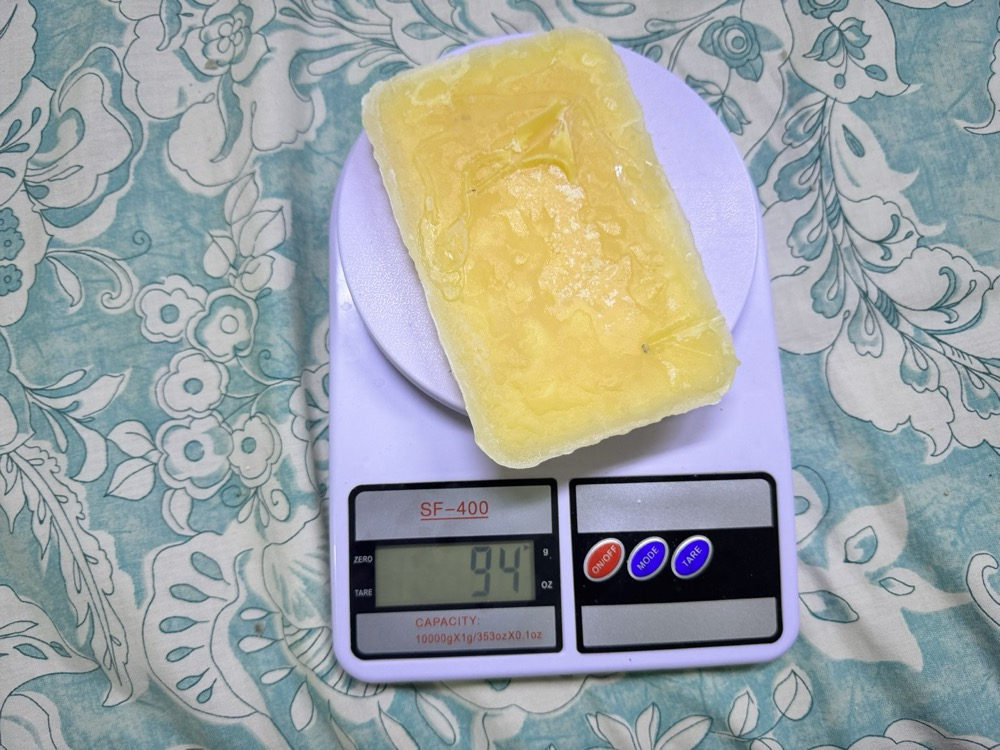
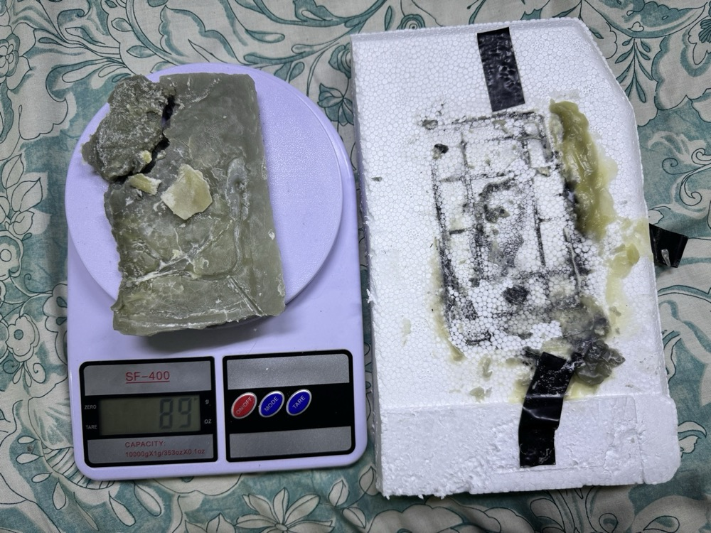

<p align="center">
  
</p>

<p align="center">
  
  
  
  
  
</p>

<p align="center">
  <a href="#-the-project">The project</a> ·
  <a href="#-the-field-test">The field test</a> ·
  <a href="#-the-predictions">Predictions</a> ·
  <a href="#-results-three-days">Results</a> ·
  <a href="#-hardware">Hardware</a> ·
  <a href="#-calibration">Calibration</a> ·
  <a href="#-run-it-yourself">Run it</a> ·
  <a href="#-repository-map">Repo map</a>
</p>

---

Firmware, logging scripts, calibration, field data and analysis for the outdoor test of a
**rice bran wax / lauric acid phase-change material (PCM)** on the back of small solar
panels mounted as **roof-integrated panels** (insulated back). The question it answers:
*does the PCM slab make such a panel run cooler in the sun, and does it stay put?*

## ☀️ The project

Solar panels lose output as they heat up, about **0.43 % of maximum power per °C** for
crystalline silicon. **Roof-integrated panels** are the worst case: their back is closed
against the building, so no air cools it, and fins or rear ventilation can't be added.
On our test roof the back of a bare insulated panel reached **≈ 70 °C**.

A **phase-change material** on the back of the panel can soak up heat as it melts, then
release it when it re-freezes. The catch is that a melted PCM is a liquid and **leaks**.
Our idea is to hold the PCM in a **wax network**, with no container:

| | Material | Why |
|---|---|---|
| 🧈 **Matrix** | **Rice bran wax (RBW)**, a by-product of rice-bran-oil refining | Melts at ≈ 70–79 °C, so its crystal network should stay solid at panel temperature. A rice-milling residue in Pakistan, where the team is from. |
| 🧪 **PCM** | **Lauric acid**, a C12 fatty acid | Melts at **43.8 °C**, inside the panel's working range. |

The lab half of the project measures how much molten lauric acid the wax network retains
at 50, 60 and 70 °C. The **C40** composite (40 wt % lauric acid) used here passed the
≤ 2 % loss criterion at 50 and 60 °C and failed at 70 °C. **This repository is the
outdoor half**: hypothesis **H7**.

> **H7, field cooling.** The composite lowers the panel's back-surface temperature by
> **at least 2 °C** compared with a bare panel on the same day.

## 🔬 The field test

Run on a roof in **Al Khobar, Saudi Arabia**, on **15, 16 and 17 October 2026**. Full procedure and every difference from the original plan:
[`Hardware/Field Test - Run Script.md`](Hardware/Field%20Test%20-%20Run%20Script.md).

| Sensor | Station | Behind the panel |
|:---:|---|---|
| S3 | 🅰️ **Bare** | nothing, panel on its insulation board |
| S2 | 🅱️ **RBW alone** | 1 cm rice bran wax slab: adds mass, doesn't melt in this range |
| S1 | 🅲 **C40 composite** | 1 cm slab, 40 wt % lauric acid / 60 wt % RBW |
| S0 | 🅳 **C40 + graphite** | 1 cm C40 slab with ≈ 3.8 wt % graphite (higher conductivity) |



- **No container.** Slabs (**14 × 7 × 1 cm**, measured after the test; earlier notes said
  ≈ 2 cm) sit between panel (**3 × 5 in**, 7.6 × 12.7 cm) and board, notched round the lead
  joints, covering ≈ 92 % of the panel back.
- **Every panel insulated the same way**, bare included, so the bare panel is not cooled by
  air the others can't reach.
- **Sensors** are taped to each panel's back just below the slab's lower edge, at the same
  measured spot on all four. That spot has no composite directly behind it, so it
  **understates** any effect under the slab.
- **Open-circuit leads** on every panel.
- **Rotation:** whole stations move one spot along the row each morning. Slabs stay on
  their own panel, so panel-to-panel bias needs a **bare calibration run** (see status).

## 🎯 The predictions

A lumped two-node thermal model, run **before** the field days, gives the prediction the
results are tested against. Two versions exist, both recorded before any field data.

| | v1 ([`model/pcm_panel_model_v1.py`](model/pcm_panel_model_v1.py)) | v2 ([`model/pcm_panel_model.py`](model/pcm_panel_model.py)) |
|---|---|---|
| Design | open rack, 2 cm composite | **insulated back (roof-integrated), 2 cm C40** |
| Physics | convection only | convection **+ long-wave radiation** |
| Bare peak | 61.5 °C | 59.2 °C |
| Composite peak ΔT | **−5.3 °C (hotter)** | **+1.9 °C (cooler)** |
| RBW-only peak ΔT | — | +0.8 °C |
| Graphite vs composite | helps (needs k > 1 W/m·K) | **no detectable difference** |

The field result is compared against **v2**, which describes the design actually run.
v1 is kept as the record of what was predicted first. Both use a synthetic October
climate of **15–29 °C**; Al Khobar was **33–41 °C**, so absolute temperatures ran higher than
either model. Both assume **2 cm** slabs; the slabs turned out to be **1 cm**, for which the same
v2 model gives C40 **+0.8 °C** (reference only, not a new prediction).

## 📈 Results, three days

<picture>
  <source media="(prefers-color-scheme: dark)" srcset="assets/field_days_dark.png">
  
</picture>

<picture>
  <source media="(prefers-color-scheme: dark)" srcset="assets/field_summary_dark.png">
  
</picture>

Ice-corrected temperatures, weather from Open-Meteo (model data, not measured on site). Every
reading is plotted; numbers come from [`analysis/field_results.txt`](analysis/field_results.txt).

**Pre-registered main number:** each slab panel's daily peak subtracted from the bare panel's
peak that day. Positive = cooler than bare.

| | Day 1 | Day 2 | Day 3 | Mean ± SD (n = 3) | v2 prediction | Mass over ≈ 72 h |
|---|---:|---:|---:|---:|---:|---:|
| Bare peak | 63.6 °C | 69.9 °C | 76.1 °C | | 59.2 °C | |
| **RBW alone** | +6.2 | +3.2 | +10.7 | **+6.7 ± 3.7** | +0.8 | 98 → 98 g, **0 %** |
| **C40** | +6.1 | +1.6 | +11.9 | **+6.5 ± 5.2** | +1.9 | 96 → 94 g, **2.1 %** |
| **C40 + graphite** | +4.5 | −0.2 | +8.1 | **+4.1 ± 4.2** | +2.1 | 100 → 89 g, **11 %** |
| C40 vs RBW | −0.1 | −1.7 | +1.2 | −0.2 ± 1.4 | ≈ +1.1 | |

**What it shows.**

1. **A 1 cm slab took ≈ 6.5 °C off the peak of a roof-integrated panel**, more on hotter
   days (11.9 °C on Day 3, when bare reached 76 °C). **H7 (≥ 2 °C) is met on the mean**, and the
   cooling is three times the model's prediction. With three days the 95 % CI still includes
   zero: consistent, not statistically proven.
2. **Most of it is thermal mass.** Plain wax did as well as C40 at peak.
3. **Melting showed up on the hottest day and in the evening.** On Day 3, from ≈ 13:05 to
   14:45, C40 ran **≈ 8 °C cooler than plain wax** (row checked every 30 min, not shaded). After
   sunset C40 cooled at **4.5–5.9 °C/h at 42–44 °C** on Day 2, against 14–24 °C/h for bare:
   the acid freezing and giving its heat back (post-hoc analysis).
4. **Graphite failed twice.** Warmer than C40 at peak every day (by 1.7–3.8 °C), and the slab
   collapsed and lost **11 %** of its mass.
5. **C40 held together in service.** 2.1 % mass loss over ≈ 72 h on panels reaching 64–76 °C,
   at the 2 % limit; plain wax lost nothing, so the loss is the acid.
6. **Evening release.** After sunset the slab panels stay 0.6–1.4 °C warmer than bare.

<table>
<tr>
<td width="50%"></td>
<td width="25%"></td>
<td width="25%"></td>
</tr>
<tr>
<td>The four stations on the roof, Al Khobar.</td>
<td>C40 after the test: 94 g, intact.</td>
<td>C40 + graphite after: 89 g, broken; melt pooled on its board.</td>
</tr>
</table>

**Limitations, stated plainly.** ⚠️

- **One panel per treatment, three days.** The bare calibration run's log wasn't available, so
  panel bias is **bounded after sunset** instead: with no sun the panels came back to within
  0.14 °C (RBW) and 0.54 °C (C40) of bare. Correcting by those bounds *raises* the C40 cooling
  to 7.1 °C (every day ≥ 2 °C), but it can't rule out a bias of the other sign or one that only
  shows in sunlight.
- **Shadows:** Day 2 from ≈ 13:22, Day 3 from ≈ 14:45. Shown, not used for findings.
- **Day 1** started after the peak, in a gusty sea breeze.
- **Weather is model data**; **sensors sit below the slab edge**; mass on a **1 g scale**.
- **Slabs were 1 cm**, not the 2 cm the prediction assumed; **mini panels**, not full-size.

### Data format

```text
elapsed_s,clock_approx,S0_graphite,S1_c40,S2_rbw,S3_bare
2,11:47:02,62.5000,59.1875,64.1875,66.1250
```

Values are **raw**; add the ice offsets before comparing sensors. Lines starting with `#`
are metadata. The `*_raw_serial.txt` files are exact Serial Monitor copies and are never
edited.

## 🗂️ Repository map

```text
Field-Test/
├── README.md
├── assets/                         banner and figures (light + dark)
├── analysis/
│   ├── field_analysis.py           ★ every number and figure in the README
│   └── field_results.txt           its output
├── model/
│   ├── pcm_panel_model.py          v2 prediction (radiation, insulated back)
│   └── pcm_panel_model_v1.py       v1 prediction, kept as recorded
├── docs/
│   └── calibration.md              calibration method, numbers and limits
└── Hardware/
    ├── logs/                       ★ field data (raw + clean) and Al Khobar weather
    ├── field_station_logger/       ★ logger: reads sensors by ID, marks moves
    ├── field_logger_pc.py          laptop logger with clock time and move marks
    ├── uno_field_logger/           earlier logger (by ID, no station names)
    ├── ds18b20_calibration_test/   ice-offset calibration, used to log Days 1–2
    ├── esp32_field_logger/         Wi-Fi logger (not used)
    ├── Field Test - Run Script.md  procedure as run, and planned vs done
    ├── field_test_circuit_sim.html interactive wiring sketch (original 7-sensor plan)
    └── …                           earlier sketches, thermal chamber, calibration notes
```

## ✅ Status

- [x] Sensors wired; calibration with held-out room check (0.11 °C spread)
- [x] Sensor-to-station mapping confirmed by finger test (16 Oct)
- [x] Field Days 1–3 (15–17 Oct) logged and analysed with weather
- [x] Slab size (14 × 7 × 1 cm) and masses before and after
- [ ] Bare calibration run analysed and applied as a per-panel correction
- [ ] Oven test: C40 vs C40 + graphite side by side at 60 and 70 °C

## 👥 Team

**Ahmad Hassan Raza** and **Ayaan Kaazmi**, Cadet College Hasanabdal, Pakistan.
Field test carried out in Al Khobar, Saudi Arabia.
Category: Energy, Sustainable Materials and Design.
