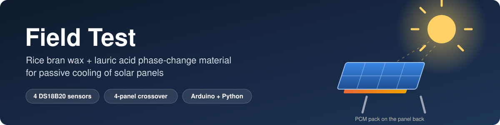
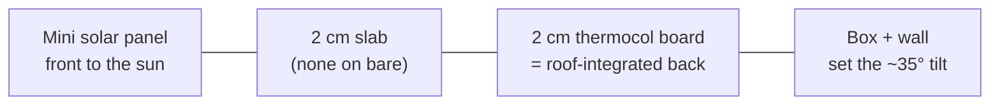
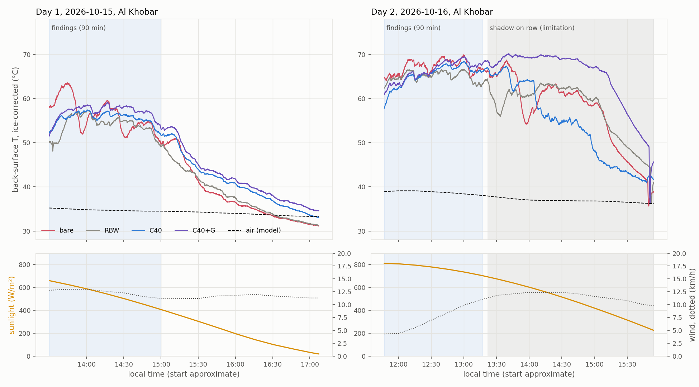
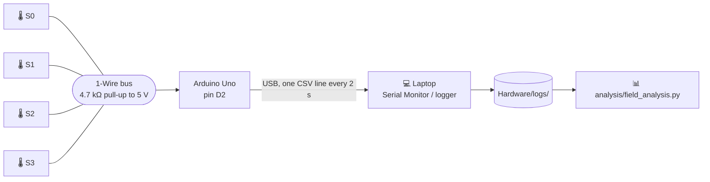

<p align="center">
  
</p>

<p align="center">
  
  
  
  
  
</p>

<p align="center">
  <a href="#-the-project">The project</a> ·
  <a href="#-the-field-test">The field test</a> ·
  <a href="#-the-predictions">Predictions</a> ·
  <a href="#-results-days-1-and-2">Results</a> ·
  <a href="#-hardware">Hardware</a> ·
  <a href="#-calibration">Calibration</a> ·
  <a href="#-run-it-yourself">Run it</a> ·
  <a href="#-repository-map">Repo map</a>
</p>

---

Firmware, logging scripts, calibration, field data and analysis for the outdoor test of a
**rice bran wax / lauric acid phase-change material (PCM)** on the back of small solar
panels mounted as **roof-integrated panels** (insulated back). The question it answers:
*does the PCM slab make such a panel run cooler in the sun, and does it stay put?*

## ☀️ The project

Solar panels lose output as they heat up, about **0.43 % of maximum power per °C** for
crystalline silicon. **Roof-integrated panels** are the worst case: their back is closed
against the building, so no air cools it, and fins or rear ventilation can't be added.
On our test roof the back of a bare insulated panel reached **≈ 70 °C**.

A **phase-change material** on the back of the panel can soak up heat as it melts, then
release it when it re-freezes. The catch is that a melted PCM is a liquid and **leaks**.
Our idea is to hold the PCM in a **wax network**, with no container:

| | Material | Why |
|---|---|---|
| 🧈 **Matrix** | **Rice bran wax (RBW)**, a by-product of rice-bran-oil refining | Melts at ≈ 70–79 °C, so its crystal network should stay solid at panel temperature. A rice-milling residue in Pakistan, where the team is from. |
| 🧪 **PCM** | **Lauric acid**, a C12 fatty acid | Melts at **43.8 °C**, inside the panel's working range. |

The lab half of the project measures how much molten lauric acid the wax network retains
at 50, 60 and 70 °C. The **C40** composite (40 wt % lauric acid) used here passed the
≤ 2 % loss criterion at 50 and 60 °C and failed at 70 °C. **This repository is the
outdoor half**: hypothesis **H7**.

> **H7, field cooling.** The composite lowers the panel's back-surface temperature by
> **at least 2 °C** compared with a bare panel on the same day.

## 🔬 The field test

Run on a roof in **Al Khobar, Saudi Arabia**, on **15 and 16 October 2026**, with a third
day on 17 October. Full procedure and every difference from the original plan:
[`Hardware/Field Test - Run Script.md`](Hardware/Field%20Test%20-%20Run%20Script.md).

| Sensor | Station | Behind the panel |
|:---:|---|---|
| S3 | 🅰️ **Bare** | nothing, panel on its insulation board |
| S2 | 🅱️ **RBW alone** | 2 cm rice bran wax slab: adds mass, doesn't melt in this range |
| S1 | 🅲 **C40 composite** | 2 cm slab, 40 wt % lauric acid / 60 wt % RBW |
| S0 | 🅳 **C40 + graphite** | 2 cm C40 slab with ≈ 3.8 wt % graphite (higher conductivity) |



- **No container.** Slabs sit between panel and board, notched round the lead joints and
  covering ≈ 85 % of the panel back.
- **Every panel insulated the same way**, bare included, so the bare panel is not cooled by
  air the others can't reach.
- **Sensors** are taped to each panel's back just below the slab's lower edge, at the same
  measured spot on all four. That spot has no composite directly behind it, so it
  **understates** any effect under the slab.
- **Open-circuit leads** on every panel.
- **Rotation:** whole stations move one spot along the row each morning. Slabs stay on
  their own panel, so panel-to-panel bias needs a **bare calibration run** (see status).

## 🎯 The predictions

A lumped two-node thermal model, run **before** the field days, gives the prediction the
results are tested against. Two versions exist, both recorded before any field data.

| | v1 ([`model/pcm_panel_model_v1.py`](model/pcm_panel_model_v1.py)) | v2 ([`model/pcm_panel_model.py`](model/pcm_panel_model.py)) |
|---|---|---|
| Design | open rack, 2 cm composite | **insulated back (roof-integrated), 2 cm C40** |
| Physics | convection only | convection **+ long-wave radiation** |
| Bare peak | 61.5 °C | 59.2 °C |
| Composite peak ΔT | **−5.3 °C (hotter)** | **+1.9 °C (cooler)** |
| RBW-only peak ΔT | — | +0.8 °C |
| Graphite vs composite | helps (needs k > 1 W/m·K) | **no detectable difference** |

The field result is compared against **v2**, which describes the design actually run.
v1 is kept as the record of what was predicted first. Both use a synthetic October
climate of **15–29 °C**; Al Khobar was **33–39 °C**, so absolute temperatures ran higher than
either model.

## 📈 Results, days 1 and 2

<picture>
  <source media="(prefers-color-scheme: dark)" srcset="assets/field_days_dark.png">
  
</picture>

Ice-corrected temperatures, weather from Open-Meteo (model data, not measured on site).
Every reading is plotted; numbers come from [`analysis/field_results.txt`](analysis/field_results.txt).

**Findings window: the first 90 minutes of each day.** Positive = the station is cooler than bare.

| | Day 1 (13:30–15:00) | Day 2 (11:47–13:17) | Matched sun ≥ 600 W/m², both days | v2 prediction (peak) |
|---|---:|---:|---:|---:|
| Weather | 543 W/m², 34.7 °C, wind 12 km/h | **771 W/m², 38.8 °C, wind 7 km/h** | 3,615 readings | |
| **C40**, mean / peak | +0.7 / +6.1 | **+1.8 / +1.6** | **+2.4** | +1.9 |
| RBW alone, mean / peak | +2.3 / +6.2 | +2.1 / +3.2 | +3.1 | +0.8 |
| C40 + graphite, mean / peak | −0.8 / +4.5 | +1.0 / +0.4 | +1.5 | +2.1 to +2.2 |
| C40 vs RBW (mean) | RBW 1.6 cooler | RBW 0.3 cooler | RBW 0.8 cooler | C40 ≈ 1.1 cooler |

**What it shows.**

1. **Any 2 cm slab kept the roof-integrated panel ≈ 2–3 °C cooler in strong sun.** On the
   clear day the C40 panel ran **1.6 °C** cooler at peak, close to the v2 prediction of
   1.9 °C. **H7 (≥ 2 °C) is not met**, just below the threshold.
2. **No extra benefit from melting could be detected.** The wax-only slab did as well as or
   better than C40 on both days. The cooling is mostly mass and insulation.
3. **Graphite did not help**, and the C40 + graphite slab **partly collapsed and flowed** on
   Day 2. It spent **105 min above 68 °C** (C40: 4 min), consistent with C40 failing
   retention at 70 °C in the lab. Whether graphite also weakens the network is untested.
4. **Peak damping and evening release.** On Day 1 a burst of sun took the bare panel to
   63.6 °C while the slab panels stayed near 57 °C. After ≈ 15:30 the two composite panels ran
   2–5 °C *warmer* than bare (wax alone ≈ 1 °C) as they gave back stored heat, as the model predicts.

**Limitations, stated plainly.** ⚠️

- **One panel per treatment** and **no bare calibration correction applied yet**: part of
  the differences may be the panels or their positions, not the slabs.
- **Day 2 after ≈ 13:22:** a shadow crosses the row (panels drop one after another while
  sunlight falls smoothly, so not cloud). Shown, not used for findings.
- **Day 1** started after the peak and in a gusty sea breeze (≈ 12 km/h).
- **Two days, afternoons only, no night logging**; start times approximate.
- **Weather is model data**, not a sensor on the roof.
- **Sensors below the slab edge** understate the effect under the slab.

## 🔌 Hardware



| Part | Details |
|---|---|
| Sensors | 4 × DS18B20 waterproof probes, 12-bit (0.0625 °C steps), one 1-Wire bus |
| Wiring | Red → 5 V rail, black → GND rail, yellow → DATA rail → **D2**; **4.7 kΩ** from 5 V to DATA |
| Logger | Arduino Uno over USB; Days 1–2 logged with the calibration sketch in idle mode |
| Identity | **Use the ROM address, not the bus order.** Day 1 was first labelled by breadboard order and was wrong. [`field_station_logger`](Hardware/field_station_logger/field_station_logger.ino) reads each sensor by address and names the columns by station. |

Readings of **−127** mean a sensor dropped off the bus; **85.0** is the power-on value. Both
are excluded, never filled in.

## 🎯 Calibration

All four sensor tips were bundled and calibrated with a **one-point ice-bath offset**, then
checked in room-temperature water that was **not** used to set the offsets. Full write-up:
[`docs/calibration.md`](docs/calibration.md).

| Sensor | Station | Ice mean (°C) | Offset (°C) | Room check corrected (°C) |
|---|---|---:|---:|---:|
| S0 | C40 + graphite | 1.606 | −1.606 | 28.375 |
| S1 | C40 | 1.388 | −1.388 | 28.325 |
| S2 | RBW alone | 1.863 | −1.863 | 28.263 |
| S3 | Bare | 1.369 | −1.369 | 28.375 |

**Raw spread 0.41 °C → corrected spread 0.11 °C.** Valid for comparing sensors with each
other; agreement at 40–70 °C has not been checked, and the ice bath sat slightly above
0 °C, so absolute temperatures carry a small bias.

## 🚀 Run it yourself

**Reproduce the results** (from the repo root):

```bash
pip install -r requirements.txt
python analysis/field_analysis.py
```

**Re-run the predictions:**

```bash
python model/pcm_panel_model.py
python model/pcm_panel_model_v1.py
```

**Log a new day.** Upload
[`Hardware/field_station_logger/field_station_logger.ino`](Hardware/field_station_logger/field_station_logger.ino)
(set `MOVE_EVERY_MIN` to 15 for a calibration run, 0 for a slab day), then either copy the
Serial Monitor output, or close it and run:

```bash
python Hardware/field_logger_pc.py --move-every 15
```

That stamps every line with the laptop's clock and lets you type `m` + Enter after each move.

### Data format

```text
elapsed_s,clock_approx,S0_graphite,S1_c40,S2_rbw,S3_bare
2,11:47:02,62.5000,59.1875,64.1875,66.1250
```

Values are **raw**; add the ice offsets before comparing sensors. Lines starting with `#`
are metadata. The `*_raw_serial.txt` files are exact Serial Monitor copies and are never
edited.

## 🗂️ Repository map

```text
Field-Test/
├── README.md
├── assets/                         banner and figures
├── analysis/
│   ├── field_analysis.py           ★ every number and figure in the README
│   └── field_results.txt           its output
├── model/
│   ├── pcm_panel_model.py          v2 prediction (radiation, insulated back)
│   └── pcm_panel_model_v1.py       v1 prediction, kept as recorded
├── docs/
│   └── calibration.md              calibration method, numbers and limits
└── Hardware/
    ├── logs/                       ★ field data (raw + clean) and Al Khobar weather
    ├── field_station_logger/       ★ logger: reads sensors by ID, marks moves
    ├── field_logger_pc.py          laptop logger with clock time and move marks
    ├── uno_field_logger/           earlier logger (by ID, no station names)
    ├── ds18b20_calibration_test/   ice-offset calibration, used to log Days 1–2
    ├── esp32_field_logger/         Wi-Fi logger (not used)
    ├── Field Test - Run Script.md  procedure as run, and planned vs done
    ├── field_test_circuit_sim.html interactive wiring sketch (original 7-sensor plan)
    └── …                           earlier sketches, thermal chamber, calibration notes
```

## ✅ Status

- [x] Sensors wired; calibration with held-out room check (0.11 °C spread)
- [x] Sensor-to-station mapping confirmed by finger test (16 Oct)
- [x] Field Day 1 (15 Oct) and Day 2 (16 Oct) logged, analysed with weather
- [ ] Field Day 3 (17 Oct)
- [ ] Bare calibration run analysed and applied as a per-panel correction
- [ ] Slab masses before and after; photos of the collapsed graphite slab
- [ ] Oven test: C40 vs C40 + graphite side by side at 60 and 70 °C

## 👥 Team

**Ahmad Hassan Raza** and **Ayaan Kaazmi**, Cadet College Hasanabdal, Pakistan.
Field test carried out in Al Khobar, Saudi Arabia.
Category: Energy, Sustainable Materials and Design.
