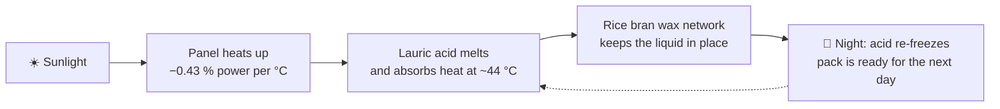
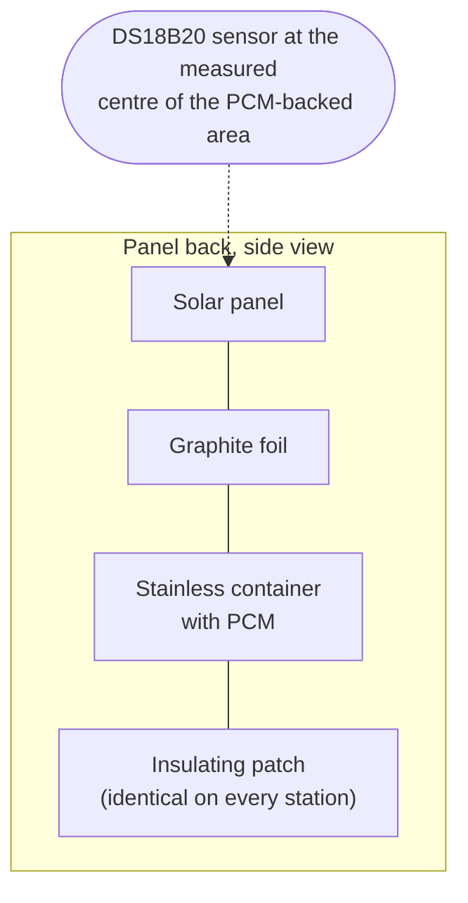
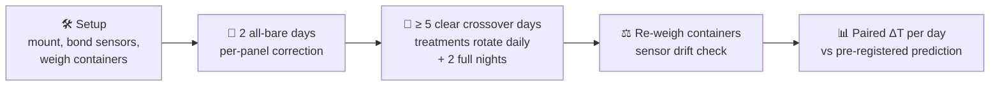
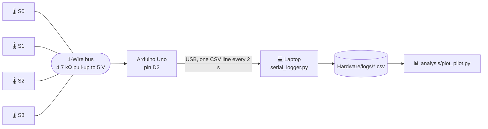
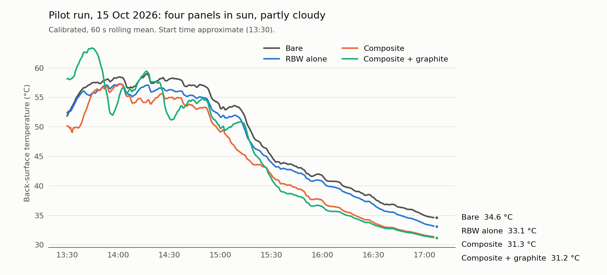
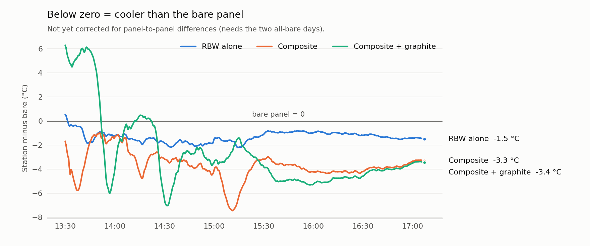

<p align="center">
  
</p>

<p align="center">
  
  
  
  
  
</p>

<p align="center">
  <a href="#-the-project">The project</a> ·
  <a href="#-the-field-test">The field test</a> ·
  <a href="#-hardware">Hardware</a> ·
  <a href="#-calibration">Calibration</a> ·
  <a href="#-pilot-run-15-october-2026">Pilot run</a> ·
  <a href="#-run-it-yourself">Run it</a> ·
  <a href="#-repository-map">Repo map</a>
</p>

---

Firmware, logging scripts, calibration and field data for the outdoor test of a
**rice bran wax / lauric acid phase-change material (PCM)** bonded to the back of
small solar panels. The question it answers: *does the PCM pack actually make a
panel run cooler in the sun?*

## ☀️ The project

Solar panels lose output as they heat up, about **0.43 % of maximum power per °C**
for crystalline silicon. On a sunny October afternoon the back of a panel here
easily passes **55–60 °C**.

A **phase-change material** stuck to the back of the panel can soak up that heat as
it melts, at nearly constant temperature, then release it overnight when it
re-freezes. No pumps, no power, no moving parts. The catch is that a melted PCM is a
liquid and **leaks** out of its container.

Our idea is to hold the PCM inside a **wax network**:

| | Material | Why |
|---|---|---|
| 🧈 **Matrix** | **Rice bran wax (RBW)**, a by-product of rice-bran-oil refining | Melts at 77–79 °C, well above panel temperature, so the network stays solid. Pakistan is a major rice producer, so it is a local agricultural residue. |
| 🧪 **PCM** | **Lauric acid**, a C12 fatty acid | Melts at **43.8 °C** with a latent heat of about 180–190 J/g, inside the panel's working range. |



The lab half of the project measures how much molten lauric acid the wax network
retains at 50, 60 and 70 °C. **This repository is the outdoor half**: hypothesis
**H7**.

> **H7, field cooling.** The optimised composite lowers the panel's back-surface
> temperature by **at least 2 °C** compared with a matched bare panel under October
> conditions. It is rejected if ΔT < 2 °C, or if ΔT is indistinguishable from zero after
> the crossover correction.

## 🔬 The field test

### Four stations

Four matched mono-crystalline panels (10–20 Wp) are mounted side by side at the same
tilt and orientation. Each carries a different treatment on its back:

| Station | Treatment | What it tells us |
|:---:|---|---|
| 🅰️ | **Bare** panel | The reference |
| 🅱️ | **Thermal-mass control** (sand in the design; RBW alone in the pilot) | Separates "it melts" from "it is just heavy". Without it, any cooling at C could be extra mass alone. |
| 🅲 | **Composite** (RBW + lauric acid) | The material under test |
| 🅳 | **Composite + graphite** at the same thickness | Graphite raises thermal conductivity, the property our model says matters most |

Each pack sits in a **316 stainless-steel container** (76 × 102 × 7.6 mm inside, about
59 cm³), filled to **~90 % (≈ 50 g)** because waxes and fatty acids expand about 10 % on
melting. Stainless is used because lauric acid pits aluminium. A **graphite foil**
sits between container and backsheet, since contact resistance, not the steel wall, is
the real thermal bottleneck.



### Controls that keep it fair

- 🔁 **Daily swap.** Treatments rotate between physical panels every day, and results
  are analysed as **paired differences within a day**. Panel, position and sensor are
  never tied to one treatment.
- 📏 **Two all-bare days first.** All four panels run bare to measure how much they
  differ on their own. That gives a per-panel correction applied to every later day.
- 🧱 **Same insulation everywhere.** A sensor under a box is shielded from wind; one on
  a bare backsheet is not. That bias would point exactly the way we hope, so every
  station, including the bare one, gets the identical insulating patch.
- 🌤️ **Clear days only.** At least **5 clear-sky days**. Cloudy days are logged and
  excluded with the reason, never averaged in.
- 🌙 **Two full nights.** Logging continues past sunset on at least two nights to look
  for a **freezing arrest**: the PCM pausing near 43.8 °C as it re-solidifies. That is the
  direct evidence that the pack resets each night.
- ⚖️ **Weighed before and after.** Every container is weighed to 0.01 g before and after
  the campaign, with catch trays photographed daily, to measure real-world leakage.

### Campaign plan



Example rotation (rows are days, columns are physical panels):

| Day | Panel 1 | Panel 2 | Panel 3 | Panel 4 |
|---|:---:|:---:|:---:|:---:|
| 1–2 | A | A | A | A |
| 3 | A | B | C | D |
| 4 | B | C | D | A |
| 5 | C | D | A | B |
| 6 | D | A | B | C |
| 7 | A | B | C | D |

### The prediction we wrote down first

Before the campaign, a lumped two-node thermal model
([`model/pcm_panel_model.py`](model/pcm_panel_model.py)) was run on our measured melting
range (43–75 °C) and literature property values. Its prediction, recorded in advance and
**not revised afterwards**:

| | Bare | With composite |
|---|---:|---:|
| Peak back-surface temperature | 61.5 °C | **66.7 °C** |
| Peak ΔT | — | **−5.3 °C (hotter)** |
| H7 (≥ 2 °C drop) | — | **not met** |

The reason: at an assumed conductivity of about 0.2 W/m·K the layer **insulates more
than it buffers**, and only ~17 % of it ever melts. The model only shows net cooling
above roughly 1 W/m·K, which is why the graphite station exists.

| k (W/m·K) | 0.2 | 0.5 | 1.0 | 2.0 | 6.0 |
|---|---:|---:|---:|---:|---:|
| Predicted peak ΔT (°C) | −5.3 | −1.2 | **+0.4** | +1.2 | +1.7 |

## 🔌 Hardware



| Part | Details |
|---|---|
| Sensors | 4 × DS18B20, 12-bit (0.0625 °C steps), all on one 1-Wire bus |
| Wiring | Red → 5 V, black → GND, yellow (data) → **D2**, **4.7 kΩ** resistor from D2 to 5 V |
| Logger | Arduino Uno over USB to a laptop (cable ≤ 5 m, laptop on mains, sleep off) |
| Identity | Each sensor is read by its unique 64-bit ROM address, so S0–S3 never swap |

| Label | ROM address |
|---|---|
| S0 | `28BAC2B4000000E8` |
| S1 | `2809627500000033` |
| S2 | `28B5357300000084` |
| S3 | `28DDDA76000000D2` |

Readings of **−127** mean a sensor dropped off the bus; **85.0** is the power-on value
(check the red wire). Both are excluded, never filled in.

An ESP32 Wi-Fi version ([`Hardware/esp32_field_logger`](Hardware/esp32_field_logger)
with [`Hardware/receive_logger.py`](Hardware/receive_logger.py)) is included but not
used yet.

## 🎯 Calibration

All four sensor tips were bundled together and calibrated with a **one-point ice-bath
offset**, then checked in room-temperature water that was **not** used to set the
offsets. Full write-up: [`docs/calibration.md`](docs/calibration.md).

| Sensor | Ice mean (°C) | Offset (°C) | Room check raw (°C) | Room check corrected (°C) |
|---|---:|---:|---:|---:|
| S0 | 1.606 | −1.606 | 29.981 | 28.375 |
| S1 | 1.388 | −1.388 | 29.713 | 28.325 |
| S2 | 1.863 | −1.863 | 30.125 | 28.263 |
| S3 | 1.369 | −1.369 | 29.744 | 28.375 |

**Raw spread 0.41 °C → corrected spread 0.11 °C.** The ice bath sat a little above 0 °C,
so absolute temperatures carry a bias. The calibration is used for what this test
needs: **comparing sensors with each other**. Agreement at 40–70 °C has not been checked
yet.

## 📈 Pilot run, 15 October 2026

A first afternoon run with all four treatments on panels in the sun, at home, before the
formal campaign. About **13:30 to 17:07**, partly cloudy, **6,514 readings** per sensor,
no dropouts.

| Sensor | Station |
|---|---|
| S0 | 🅰️ Bare |
| S1 | 🅱️ RBW alone |
| S2 | 🅲 Composite |
| S3 | 🅳 Composite + graphite |

<picture>
  <source media="(prefers-color-scheme: dark)" srcset="assets/pilot_temperatures_dark.png">
  
</picture>

<picture>
  <source media="(prefers-color-scheme: dark)" srcset="assets/pilot_delta_dark.png">
  
</picture>

Calibrated values:

| | Bare | RBW alone | Composite | Composite + graphite |
|---|---:|---:|---:|---:|
| Highest reading | 59.1 °C | 57.4 °C | 57.3 °C | 63.6 °C |
| At the end (~17:07) | 34.6 °C | 33.1 °C | 31.3 °C | 31.1 °C |
| Mean difference from bare, 14:00–17:07 | — | **−1.4 °C** | **−3.8 °C** | **−3.5 °C** |
| Time spent cooler than bare, 14:00–17:07 | — | 100 % | 100 % | 95 % |

**What it suggests.** After the first half hour every PCM station ran cooler than the
bare panel, and the composite stations by more than the 2 °C H7 asks for. That is the
**opposite of the pre-registered −5.3 °C prediction**.

**Why it is not a result yet.** ⚠️

1. **No all-bare correction.** Panels differ on their own; part of the gap may be the
   panels, not the PCM.
2. **No swap.** Each treatment stayed on one panel and one sensor all afternoon.
3. **Partly cloudy, afternoon only.** It would fail a clear-sky rule.
4. **Graphite oddity.** The graphite station ran about **5 °C hotter** than bare for the
   first 20 minutes and swings hardest when clouds pass. Its bonding and shading need
   checking before the formal days.
5. **Pilot used the calibration sketch** (idle mode) for logging, and the start time is
   approximate.

Data: [`Hardware/logs/pilot_2026-10-15.csv`](Hardware/logs/pilot_2026-10-15.csv) (clean)
and [`pilot_2026-10-15_raw_serial.txt`](Hardware/logs/pilot_2026-10-15_raw_serial.txt)
(exact Serial Monitor copy).

## 🚀 Run it yourself

**1. Flash the logger.** Open
[`Hardware/uno_field_logger/uno_field_logger.ino`](Hardware/uno_field_logger/uno_field_logger.ino)
in the Arduino IDE, install the **OneWire** and **DallasTemperature** libraries, pick the
Uno's port and upload. Or with `arduino-cli`:

```bash
arduino-cli compile --upload -p COM3 --fqbn arduino:avr:uno Hardware/uno_field_logger
```

**2. Log to the laptop.** Close the Serial Monitor (only one program can hold the port),
set `PORT` in [`Hardware/serial_logger.py`](Hardware/serial_logger.py), then:

```bash
pip install pyserial
python Hardware/serial_logger.py
```

Every line is written and flushed to `Hardware/logs/` as it arrives, so a crash loses
nothing.

**3. Plot.**

```bash
pip install pandas matplotlib
python analysis/plot_pilot.py
```

**4. Re-run the prediction.**

```bash
pip install numpy matplotlib
python model/pcm_panel_model.py
```

### Data format

```text
elapsed_s,clock_approx,S0_bare,S1_rbw,S2_composite,S3_graphite
2,13:30:02,53.1250,53.5625,51.9375,59.3750
```

Values are **raw**. Add the ice offsets from the calibration table before comparing
sensors. Lines starting with `#` are metadata.

## 🗂️ Repository map

```text
Field-Test/
├── README.md
├── assets/                         banner and figures
├── analysis/
│   └── plot_pilot.py               figures for the pilot run
├── model/
│   └── pcm_panel_model.py          pre-registered panel thermal model (H7 prediction)
├── docs/
│   └── calibration.md              calibration method, numbers and limits
└── Hardware/
    ├── uno_field_logger/           ★ field logger: 4 sensors → USB CSV every 2 s
    ├── ds18b20_calibration_test/   ice-offset calibration with held-out checks
    ├── esp32_field_logger/         Wi-Fi logger (not used yet)
    ├── serial_logger.py            ★ laptop side: saves every line to logs/
    ├── receive_logger.py           Wi-Fi receiver for the ESP32 version
    ├── logs/                       ★ field data
    ├── Field Test - Run Script.md  day-by-day procedure and open decisions
    ├── field_test_circuit_sim.html interactive wiring sketch
    └── …                           earlier sketches, thermal chamber, calibration notes
```

## ✅ Status

- [x] Sensors wired and found on the bus
- [x] Calibration: ice offsets plus held-out room check (0.11 °C spread)
- [x] Field logger written and compiled for the Uno
- [x] Pilot afternoon run logged and saved
- [ ] Ambient sensor and clear-sky rule decided
- [ ] Two all-bare calibration days
- [ ] ≥ 5 clear crossover days with daily swap, plus 2 full nights
- [ ] Containers re-weighed, sensor drift check
- [ ] Paired ΔT analysis against the pre-registered prediction

## 👥 Team

**Ahmad Hassan Raza** and **Ayaan Kaazmi**, Cadet College Hasanabdal, Pakistan.
Category: Energy, Sustainable Materials and Design.
